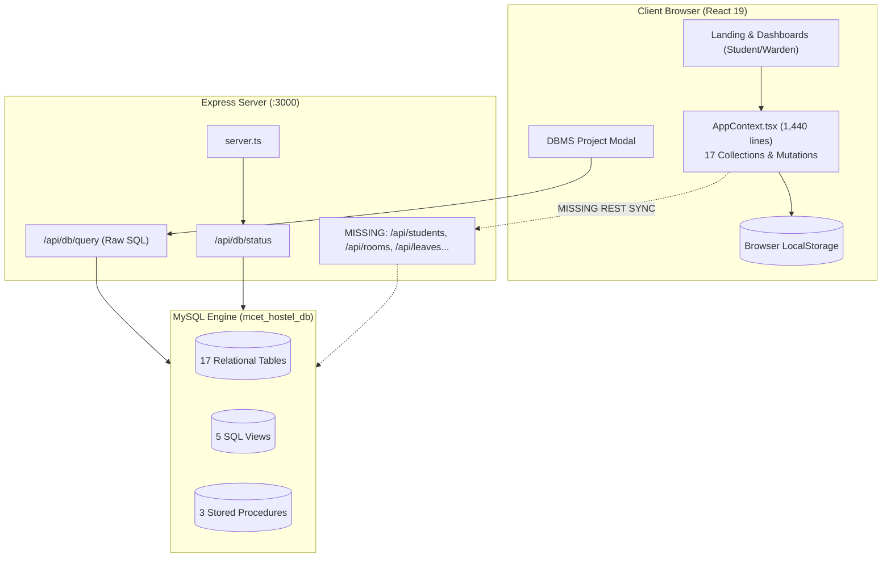

# Sakhi Girls Hostel ERP — Architectural Audit & Enterprise Modernization Roadmap

**Version:** 1.0.0  
**Role:** Senior Software Architect & Principal Full-Stack Engineer  
**Scope:** Architecture inspection, gap analysis, and phased professionalization plan for `sakhi-girls-hostel-mcet`

---

## 1. Executive Summary & Existing System State

The application is a full-stack residential operations portal designed specifically for **Sakhi Girls Hostel** at **Mauli College of Engineering & Technology (MCET), Shegaon**. It caters to 1st through 4th year female engineering scholars across 6 departments (CS, IT, ENTC, ELPO, CIVIL, MECHANICAL).

### Technology Stack Overview
| Layer | Existing Implementation | Architectural Status |
| :--- | :--- | :--- |
| **Frontend Framework** | React 19 + TypeScript + Vite | Modern, high performance |
| **Styling & Theme** | Tailwind CSS v4 + Motion + CSS Custom Properties | Dual-theme (Light boutique & Dark obsidian), accessible |
| **Icons & Media** | Lucide React + Canvas Confetti + HLS.js | Clean and reactive |
| **State Management** | Monolithic `AppContext.tsx` (1,440+ lines) with `localStorage` persistence | **Grave Tech Debt** — Needs modularization & API synchronization |
| **Backend Framework** | Node.js + Express 4 + tsx | Minimalist entrypoint (`server.ts`, 94 lines) |
| **Database Engine** | MySQL 8.0+ / 26.10+ (`mysql2/promise` pool) | **Solid 3NF Normalized Relational Schema** (17 tables, 5 views, 3 procedures) |
| **API Architecture** | Direct raw SQL endpoint (`/api/db/query`) + status | **Major Gap** — Lacks structured domain REST routes/controllers/services |

---

## 2. Deep Inspection & Gap Analysis



### Critical Gaps Identified:
1. **Disconnected Persistence Loop:**
   - The MySQL database has 17 rich, normalized tables (`students`, `rooms`, `beds`, `leave_requests`, `complaints`, `mess_menu`, `meal_attendance`, etc.), but the frontend UI primarily mutates in-memory React state and `localStorage`.
   - The Express backend only exposed `/api/db/query` (for the SQL sandbox modal) and `/api/db/status`. It did not offer RESTful endpoints for the actual application features (e.g. allocating a room bed, creating a leave pass, submitting a complaint).
2. **Monolithic Architecture in `AppContext.tsx`:**
   - 1,440 lines handling 17 different domains simultaneously.
   - Business logic is mixed with state updates, UI flags, audio/haptic feedback, and local storage serialization.
3. **Flat Backend Directory Structure:**
   - The `server/` folder only contained `db.ts`, `seed-all-to-mysql.ts`, and `export-schema-sql.ts`.
   - Missing industry-standard layering: `config/`, `controllers/`, `services/`, `routes/`, `middleware/`, and `utils/`.
4. **Dead / Orphan Code:**
   - `src/components/CtaFooter.tsx` (92 lines) is completely unreferenced and obsolete.

---

## 3. Targeted Production-Ready Architecture

```mermaid
graph LR
    subgraph Frontend ["Frontend Layer (src/)"]
        Pages["Pages / Dashboards"] --> FeatureHooks["Custom Domain Hooks"]
        FeatureHooks --> AppCtx["Modular App Context"]
        AppCtx --> ApiServices["src/services/api/ (Typed Clients)"]
    end

    subgraph Backend ["Layered Backend (server/)"]
        Router["Express Modular Routers (/api/...)"]
        Controllers["Controllers (HTTP transport & DTO validation)"]
        Services["Services (Business logic & MySQL transactions)"]
        DB["Database Pool (server/db/index.ts)"]
        
        Router --> Controllers
        Controllers --> Services
        Services --> DB
    end

    subgraph DataStore ["Persistence"]
        MySQL[("MySQL 8.0+ Enterprise DB")]
    end

    ApiServices -->|JSON REST with Fallback| Router
    DB --> MySQL
```



### Industry-Standard Directory Layout:

```
cinematic-cta-and-footer/
├── server/
│   ├── config/             # Centralized environment & app settings
│   │   └── index.ts
│   ├── utils/              # Standardized API responses & custom HTTP errors
│   │   ├── apiResponse.ts
│   │   └── apiError.ts
│   ├── middleware/         # Logging, validation, and error-handling middleware
│   │   ├── errorHandler.ts
│   │   └── requestLogger.ts
│   ├── services/           # Business logic & MySQL parameterized query execution
│   │   ├── student.service.ts
│   │   ├── room.service.ts
│   │   ├── leave.service.ts
│   │   ├── complaint.service.ts
│   │   ├── mess.service.ts
│   │   └── analytics.service.ts
│   ├── controllers/        # Request handling, input validation, and response mapping
│   │   ├── student.controller.ts
│   │   ├── room.controller.ts
│   │   ├── leave.controller.ts
│   │   ├── complaint.controller.ts
│   │   ├── mess.controller.ts
│   │   └── analytics.controller.ts
│   ├── routes/             # Modular Express routers
│   │   ├── api.router.ts   # Main router aggregator (/api)
│   │   ├── student.routes.ts
│   │   ├── room.routes.ts
│   │   ├── leave.routes.ts
│   │   ├── complaint.routes.ts
│   │   ├── mess.routes.ts
│   │   └── db.routes.ts
│   └── db/                 # Connection pool & health checker
│       └── index.ts
├── src/
│   ├── services/           # Type-safe frontend HTTP client layer
│   │   └── api/
│   │       ├── client.ts
│   │       ├── studentApi.ts
│   │       ├── roomApi.ts
│   │       ├── leaveApi.ts
│   │       ├── complaintApi.ts
│   │       └── messApi.ts
│   ├── components/         # Clean UI components
│   └── context/            # React state & sync layer
├── database/
│   └── schema.sql          # 3NF Relational Database Schema
└── server.ts               # Clean, concise server bootstrap entrypoint
```

---

## 4. Phased Implementation Plan

### Phase 1: Backend Layering & REST API Development
1. **Config & Utils**: Establish `server/config/`, `server/utils/apiResponse.ts`, `server/utils/apiError.ts`.
2. **Middleware**: Implement `server/middleware/errorHandler.ts` and `requestLogger.ts`.
3. **Domain Services & Controllers**: Implement parameterized MySQL operations for:
   - Students & admissions
   - Rooms, floors, and bed allocations
   - Leave requests & QR gate pass approvals
   - Student complaints & SLA resolution
   - Annapurna mess menu, meal attendance, and rebate calculations
   - Academic analytics & MySQL floor metrics
4. **Modular Routers**: Assemble and test all REST endpoints under `/api`.
5. **Streamline `server.ts`**: Delegate routes cleanly to `server/routes/api.router.ts`.

### Phase 2: Frontend API Client Layer & Hybrid Synchronization
1. Create `src/services/api/client.ts` with error normalization and offline fallback.
2. Connect `AppContext.tsx` mutations to call backend REST endpoints while updating optimistic state.
3. Preserve offline capability when the network or MySQL server is detached.

### Phase 3: Code Cleanup & Quality Assurance
1. Delete obsolete `src/components/CtaFooter.tsx`.
2. Run full TypeScript static analysis (`npx tsc --noEmit`).
3. Verify dev server and test all endpoints with realistic payloads.
4. Verify student and warden flows end-to-end.
