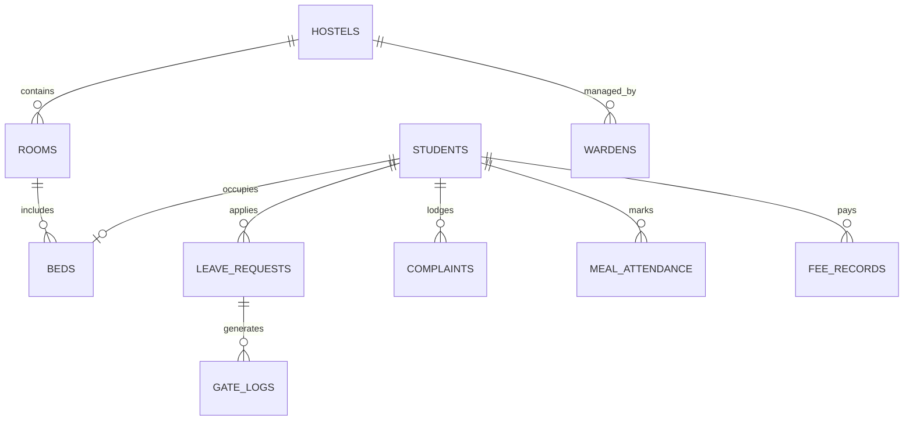

# Sakhi Girls Hostel ERP — DBMS College Presentation & Viva Master Guide

**Project Title:** Sakhi Girls Hostel Residential Living & ERP Campus Portal  
**Institution:** Mauli College of Engineering & Technology (MCET), Shegaon  
**Academic Subject:** Database Management Systems (DBMS / Relational Database Engineering)  
**Database Name:** `mcet_hostel_db`  
**Database Tool:** MySQL 8.0+ / MySQL Server 26.10+ / MySQL Workbench  

---

## 1. Project Overview (How to Introduce Your Project)

### The Elevator Pitch (Say this in your first 30 seconds):
> *"Respected Examiners, our project is **Sakhi Girls Hostel ERP**, an enterprise-grade campus residential and living management system developed for **Mauli College of Engineering & Technology (MCET), Shegaon**.  
> The system manages the complete lifecycle of female engineering scholars across all 4 academic years (1st, 2nd, 3rd, and 4th Year) representing 6 departments: **Computer Science, Information Technology, Electronics & Telecommunication, Electrical Power Systems, Civil Engineering, and Mechanical Engineering**.  
> From a DBMS perspective, the application is backed by a fully normalized **3NF relational database schema** comprising **17 relational tables, 5 SQL views, and 3 transactional stored procedures** running on **MySQL Workbench**, eliminating redundancy, preventing booking conflicts, and ensuring ACID-compliant residential operations."*

---

## 2. Technology Stack Breakdown (What Was Used)

| Component | Technology | Why We Used It (Examiner Answer) |
| :--- | :--- | :--- |
| **Database Engine** | **MySQL 8.0+ / Workbench** | ACID compliance, robust InnoDB foreign key cascading, stored procedures, indexing, and high query performance. |
| **Backend API** | **Node.js + Express 4 + TypeScript** | Layered architecture (Controllers, Services, Routes, Config) with parameterized queries preventing SQL injection. |
| **Frontend UI** | **React 19 + TypeScript + Vite** | Component-driven architecture, ultra-fast Virtual DOM rendering, and strict type safety. |
| **Styling & Design** | **Tailwind CSS v4 + Motion** | Fully responsive dual-theme design (Boutique Light & Obsidian Dark) with interactive transitions. |
| **Data Access** | **mysql2/promise Pool** | High-concurrency connection pooling, transaction rollback, and async/await syntax. |

---

## 3. Database Architecture & Design (Core DBMS Focus)

### 3.1 Entity-Relationship (ER) Architecture



### 3.2 Database Normalization (Key Academic Criteria)
- **1st Normal Form (1NF):** Every column contains atomic (indivisible) values. No multi-valued repeating groups. For example, roommate names are not stored as a comma-separated string in `rooms`; instead, each bed is a separate entity in the `beds` table.
- **2nd Normal Form (2NF):** All tables are in 1NF and every non-key attribute is fully functionally dependent on the entire primary key. In compound keys, there is no partial dependency.
- **3rd Normal Form (3NF):** All tables are in 2NF and there are **no transitive dependencies** ($A \to B$ and $B \to C$). Student parent details, room capacities, and fee amounts depend strictly on their respective primary keys.

---

## 4. The 17 Relational Tables Explained

### Group 1: Infrastructure & Accommodation (Core Hierarchy)
1. **`hostels`**: Stores hostel metadata (`hostel_id`, name, code, total floors, total rooms, capacity, warden phone).
2. **`rooms`**: Physical rooms (`room_id`, `hostel_id`, `room_number`, `floor`, `capacity`, `occupied`, `room_type`, `status`). Enforces `UNIQUE (hostel_id, room_number)`.
3. **`beds`**: Individual bed slots (`bed_id`, `room_id`, `bed_number`, `status`, `student_id`, `student_name`). Enforces `UNIQUE (room_id, bed_number)`.

### Group 2: User Entities
4. **`wardens`**: Resident rector and assistant warden credentials (`warden_id`, name, email, phone, role, cabin, avatar).
5. **`students`**: Female scholars profile (`student_id`, `prn`, legal name, course, department, year, division, phone, email, parents' contact, emergency contact, room and bed foreign keys).

### Group 3: Movement, Security & Governance
6. **`leave_requests`**: Outstation leaves & town passes (`leave_id`, `student_id`, dates, total days, reason, destination, status, `gate_pass_code`, parent verification, `approved_by`).
7. **`gate_logs`**: Sentry biometric & QR logs (`log_id`, `gate_pass_code`, `student_id`, `action`, timestamp, biometric match status).
8. **`complaints`**: Maintenance ticketing (`complaint_id`, `student_id`, room number, category, description, urgency, status, `resolved_by`, resolution timestamp).
9. **`room_change_requests`**: Room change workflow (`request_id`, current room, preferred room, reason, warden approval).

### Group 4: Annapurna Dining & Mess Operations
10. **`mess_menu`**: Weekly 4-meal nutritional schedule (`menu_id`, `day_of_week`, breakfast, lunch, snacks, dinner).
11. **`meal_attendance`**: Token attendance (`attendance_id`, `student_id`, date, `meal_type`, token number, presence status).
12. **`mess_feedback`**: Student rating & meal critique (`feedback_id`, meal date, rating 1-5, comments).
13. **`mess_inventory`**: Kitchen pantry stock (`item_id`, item name, category, stock qty, unit, reorder level).
14. **`mess_expenses`**: Mess operational procurement expenses (`expense_id`, vendor, category, amount, payment mode).

### Group 5: Finance & Institutional Communications
15. **`fee_records`**: Semester hostel and dining invoices (`fee_id`, student PRN, amount, semester, status, transaction ref, receipt code).
16. **`notices`**: Official circulars & anti-ragging alerts (`notice_id`, title, category, target audience, published by).
17. **`app_notifications`**: Real-time dispatched alerts (`notification_id`, recipient ID, message, read flag, timestamp).

---

## 5. Advanced SQL Features: Views & Stored Procedures

Examiners love asking about **Views** (Virtual Tables) and **Stored Procedures** (Compiled Server Logic). Here is what you should show in MySQL Workbench:

### 5.1 SQL Views (Virtual Aggregates)

#### View 1: `v_sakhi_hostel_summary`
Aggregates live hostel availability in one fast query:
```sql
CREATE OR REPLACE VIEW v_sakhi_hostel_summary AS
SELECT 
  h.name AS hostel_name,
  h.code,
  h.gender,
  h.total_floors,
  COUNT(DISTINCT r.room_id) AS total_rooms,
  SUM(r.capacity) AS total_beds,
  SUM(r.occupied) AS occupied_beds,
  (SUM(r.capacity) - SUM(r.occupied)) AS available_beds_left,
  ROUND((SUM(r.occupied) / SUM(r.capacity)) * 100, 1) AS occupancy_pct
FROM hostels h
LEFT JOIN rooms r ON h.hostel_id = r.hostel_id
GROUP BY h.hostel_id, h.name, h.code, h.gender, h.total_floors;
```

#### View 2: `v_vacant_beds`
Instantly lists all ready-to-allot vacant beds for new admissions:
```sql
CREATE OR REPLACE VIEW v_vacant_beds AS
SELECT 
  b.bed_id,
  b.bed_number,
  r.room_number,
  r.floor,
  r.room_type,
  h.name AS hostel_name
FROM beds b
JOIN rooms r ON b.room_id = r.room_id
JOIN hostels h ON r.hostel_id = h.hostel_id
WHERE b.status = 'Available'
ORDER BY r.floor ASC, r.room_number ASC, b.bed_number ASC;
```

#### View 3: `v_department_distribution`
Breaks down residents across the 6 MCET engineering branches:
```sql
CREATE OR REPLACE VIEW v_department_distribution AS
SELECT 
  department,
  COUNT(*) AS total_female_residents,
  SUM(CASE WHEN year = '1st Year' THEN 1 ELSE 0 END) AS fe_1st_year,
  SUM(CASE WHEN year = '2nd Year' THEN 1 ELSE 0 END) AS se_2nd_year,
  SUM(CASE WHEN year = '3rd Year' THEN 1 ELSE 0 END) AS te_3rd_year,
  SUM(CASE WHEN year = '4th Year' THEN 1 ELSE 0 END) AS be_4th_year
FROM students
WHERE status = 'Active'
GROUP BY department
ORDER BY total_female_residents DESC;
```

---

### 5.2 Stored Procedures (Automated Business Rules)

#### Procedure 1: `sp_allot_bed` (Atomic Bed Booking)
Guarantees transactional integrity so two students cannot book the same bed simultaneously:
```sql
DELIMITER //
CREATE PROCEDURE sp_allot_bed(
  IN p_room_id VARCHAR(32),
  IN p_bed_id VARCHAR(32),
  IN p_student_id VARCHAR(32),
  IN p_student_name VARCHAR(128)
)
BEGIN
  DECLARE v_occupied INT;
  DECLARE v_capacity INT;
  
  START TRANSACTION;
  
  -- 1. Lock and update bed slot
  UPDATE beds 
  SET status = 'Occupied', student_id = p_student_id, student_name = p_student_name
  WHERE bed_id = p_bed_id AND room_id = p_room_id AND status = 'Available';
  
  -- 2. Recalculate room occupancy
  SELECT COUNT(*) INTO v_occupied FROM beds WHERE room_id = p_room_id AND status = 'Occupied';
  SELECT capacity INTO v_capacity FROM rooms WHERE room_id = p_room_id;
  
  UPDATE rooms 
  SET occupied = v_occupied,
      status = CASE WHEN v_occupied >= v_capacity THEN 'Full' ELSE 'Partially Occupied' END
  WHERE room_id = p_room_id;
  
  COMMIT;
END //
DELIMITER ;
```

#### Procedure 2: `sp_calculate_mess_rebate` (Dining Leave Credit)
Automates dietary fee rebate calculations when scholars take official leave:
```sql
DELIMITER //
CREATE PROCEDURE sp_calculate_mess_rebate(
  IN p_student_id VARCHAR(32),
  IN p_from_date DATE,
  IN p_to_date DATE,
  OUT p_eligible_days INT,
  OUT p_rebate_amount DECIMAL(10,2)
)
BEGIN
  DECLARE v_days INT;
  DECLARE v_daily_rate DECIMAL(10,2) DEFAULT 120.00;
  
  SET v_days = DATEDIFF(p_to_date, p_from_date);
  
  -- Institutional Policy: Minimum 2 continuous leave days required for mess rebate
  IF v_days >= 2 THEN
    SET p_eligible_days = v_days;
    SET p_rebate_amount = v_days * v_daily_rate;
  ELSE
    SET p_eligible_days = 0;
    SET p_rebate_amount = 0.00;
  END IF;
END //
DELIMITER ;
```

---

## 6. Top 10 DBMS Viva Questions & Exact Answers

1. **Q: What is Normalization, and what normal form does your database follow?**  
   *Answer:* Normalization organizes data to reduce redundancy and avoid insertion, update, and deletion anomalies. Our database is in **3rd Normal Form (3NF)**: all attributes depend strictly on the primary key, with no partial or transitive dependencies.

2. **Q: What storage engine did you choose in MySQL and why?**  
   *Answer:* We chose **InnoDB** because it supports **ACID transactions**, row-level locking, foreign key constraints with `ON DELETE CASCADE / SET NULL`, and crash recovery.

3. **Q: How does your system handle concurrent bed booking?**  
   *Answer:* Through our stored procedure `sp_allot_bed` which runs inside an **InnoDB Transaction** (`START TRANSACTION ... COMMIT`) with conditional updates (`WHERE status = 'Available'`) preventing race conditions and double bookings.

4. **Q: What is a View, and why did you create `v_sakhi_hostel_summary`?**  
   *Answer:* A View is a stored virtual table based on a SELECT query. It simplifies complex multi-table joins, enhances security by restricting raw table access, and pre-computes floor-wise occupancy metrics on demand.

5. **Q: What is the difference between a Stored Procedure and a Function?**  
   *Answer:* Stored procedures can perform complex data modifications (DML), run transactions (`COMMIT/ROLLBACK`), and return multiple `OUT` parameters or result sets. Functions cannot run transactions and must return a single deterministic scalar value.

6. **Q: How do you prevent SQL Injection in your backend?**  
   *Answer:* We use **parameterized queries** through Node.js `mysql2/promise` with prepared statement placeholders (`?`), ensuring user inputs are treated strictly as data literals and never executed as executable SQL syntax.

7. **Q: What indexes have you configured?**  
   *Answer:* Primary key indexes on all IDs (`B-Tree`), unique indexes on `prn` and `(room_id, bed_number)`, and foreign key indexes linking `hostel_id`, `room_id`, and `student_id`.

8. **Q: How does the application connect to MySQL?**  
   *Answer:* We configure a centralized connection pool (`createPool`) via `mysql2/promise` with 10 concurrent connection handles (`connectionLimit: 10`) to minimize connection establishment latency.

9. **Q: What happens when a student vacates a room?**  
   *Answer:* Calling `sp_vacate_bed` atomically updates the bed status to `Available`, clears the student foreign key, recalculates the room's `occupied` count, and updates the room status to `Available` or `Partially Occupied`.

10. **Q: How does the mess rebate calculation work in SQL?**  
    *Answer:* `sp_calculate_mess_rebate` uses `DATEDIFF()` to calculate continuous leave days. If the leave is $\ge 2$ days, it multiplies eligible days by the ₹120 daily dining rate and returns the credit amount.

---

## 7. Presentation & Live Demo Checklist

1. **Step 1:** Open **MySQL Workbench**. Show the `mcet_hostel_db` schema in the left navigator sidebar.
2. **Step 2:** Open `database/schema.sql` or run:
   ```sql
   SELECT * FROM v_sakhi_hostel_summary;
   SELECT * FROM v_department_distribution;
   ```
3. **Step 3:** Open the web portal at `http://localhost:3000`.
4. **Step 4:** Show the **Academic SQL Sandbox Modal** (click "DBMS Architecture & SQL Sandbox" in the footer or navbar). Run sample queries live in the browser to demonstrate that the UI queries MySQL directly.
5. **Step 5:** Sign in as **Pooja M. Shinde** (1st Year CS) to showcase the student quarters and digital gate pass.
6. **Step 6:** Sign in as **Dr. Sunita M. Gaikwad** (Chief Warden) to showcase real-time floor bed allotment and analytics.
